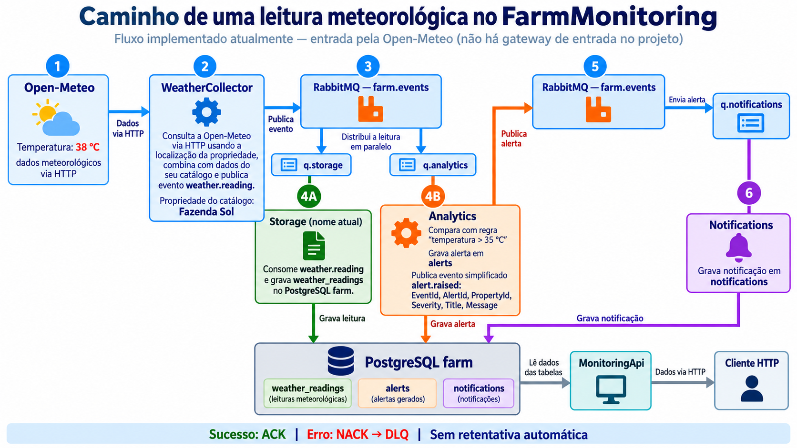

# FarmMonitoring

Sistema distribuído de monitoramento ambiental para propriedades agrícolas. O **WeatherCollector** consulta periodicamente a API Open-Meteo e publica leituras no RabbitMQ; três consumidores independentes (**Storage**, **Analytics**, **Notifications**) armazenam, analisam e notificam; a **MonitoringApi** expõe os dados via REST.

| Serviço | Pasta | Tipo |
|---|---|---|
| WeatherCollector | `API/WeatherCollector` | Worker Service |
| Storage | `API/Storage` | Worker Service |
| Analytics | `API/Analytics` | Worker Service |
| Notifications | `API/Notifications` | Worker Service |
| MonitoringApi | `API/MonitoringApi` | ASP.NET Core Web API |

Infraestrutura: PostgreSQL 17 (schema criado por [`database/init.sql`](database/init.sql)) e RabbitMQ 4 com painel de gerenciamento.

## Como encontrar a lógica

Cada projeto usa as mesmas áreas apenas quando precisa delas:

| Área | Onde procurar |
|---|---|
| `Program.cs` | Registro de dependências e inicialização do serviço. |
| `Contracts` | Eventos RabbitMQ e pedidos HTTP. A MonitoringApi devolve as próprias entidades nas rotas de consulta. |
| `Domain` | Entidades e regras dos serviços que processam eventos. As entidades com `Id` e `CreatedAt` herdam o `BaseEntity` local do serviço. |
| `MonitoringApi/Entities` | Modelos do EF Core para as tabelas que a API consulta ou altera; não representam um domínio próprio da MonitoringApi. |
| `Application` | Validação, gravação e regras do fluxo; nos consumidores, o serviço usa o `DbContext` diretamente. |
| `Infrastructure/Persistence` | `DbContext` com o mapeamento das tabelas. |
| `Infrastructure/Messaging` | Consumidor ou publicador do serviço, conexão e DLQ. |
| `Controllers` | Rotas HTTP da MonitoringApi. |

Para seguir uma leitura, comece no `ClientCollectorJob` do WeatherCollector, passe pelo `WeatherReadingService` do Storage e pelo `WeatherAnalysisService` do Analytics, e termine no `NotificationService` do Notifications. O `RabbitMqConsumerBase` de cada consumidor cuida do recebimento: ACK após sucesso; NACK para a DLQ em caso de erro. Na MonitoringApi, cada controller chama seu serviço em `Application`; os serviços consultam o `MonitoringDbContext` e devolvem as entidades. `PagedResponse` apenas acrescenta os dados da paginação.

`ProcessedEvent` usa a chave composta `(EventId, Consumer)` e não herda `BaseEntity`. Os contratos de eventos e os DTOs também ficam fora dessa herança.

## Como os serviços se comunicam



Há **dois tipos de mensagem**:

- **Leitura meteorológica** (`weather.reading`): `EventId` identifica a entrega; `CollectedAt` indica quando o job coletou; `ObservedAt` indica o horário da medição da Open-Meteo. Contém cliente, propriedade, localização e as quatro medidas. Storage salva a leitura; Analytics avalia as regras.
- **Alerta** (`alert.raised`): contém apenas `EventId`, `AlertId`, `PropertyId`, `Severity`, `Title` e `Message`. Analytics monta o texto a partir do alerta que já calculou; Notifications salva a notificação. Os detalhes da regra e da medição permanecem no alerta armazenado pelo Analytics.

O tipo já está na *routing key* do RabbitMQ. Por isso os objetos enviados não repetem `EventType` ou `Source`. Cada consumidor declara seu contrato localmente; não existe projeto compartilhado de mensageria.

Os serviços usam hoje **o mesmo banco PostgreSQL `farm`**: Storage escreve leituras, Analytics lê regras e escreve alertas, Notifications escreve notificações; MonitoringApi consulta essas tabelas e altera regras. Banco dedicado por serviço seria uma mudança de arquitetura futura.

### Quando uma entrega falha

O consumidor confirma a mensagem (**ACK**) após processá-la. Se houver erro, rejeita a mensagem (**NACK**); o RabbitMQ a envia para `q.<serviço>.dlq`. Não há retentativa automática: veja a causa no painel do RabbitMQ, corrija o problema e reenvie a mensagem manualmente quando fizer sentido. O `EventId` e a tabela `processed_events` evitam gravar novamente uma entrega duplicada. Se o serviço parar durante o processamento, a mensagem volta à fila principal.

O Analytics grava os alertas e depois publica os eventos. Há uma limitação atual: se essa publicação falhar, o alerta já salvo pode ficar sem notificação. Resolver isso exige tratar a entrega pendente explicitamente (por exemplo, com outbox) e fica fora deste fluxo introdutório.

## Como subir

Pré-requisito: Docker com Compose v2.

```bash
cp .env.example .env   # opcional; sem .env são usados os valores padrão
docker compose up --build
```

| Recurso | Endereço |
|---|---|
| MonitoringApi | http://localhost:8080 |
| PostgreSQL | `localhost:5432`, banco `farm`, usuário `farm` / senha `farm_password` |
| RabbitMQ (AMQP) | `localhost:5672` |

Para compilar localmente sem Docker: `dotnet build` na raiz.

## Painel do RabbitMQ

Acesse http://localhost:15672 com usuário `guest` e senha `guest` (ou os valores de `RABBITMQ_DEFAULT_USER` / `RABBITMQ_DEFAULT_PASS` do `.env`). Em **Queues and Streams** é possível acompanhar as filas `q.*` e `q.*.dlq`.

## Escalar consumidores

Os consumidores suportam *competing consumers*, então dá para subir várias réplicas sem alterar código:

```bash
docker compose up --build --scale analytics=3
```

O mesmo vale para `storage` e `notifications`.

## Recriar o banco

O `init.sql` só é executado quando o volume do Postgres está vazio. Para recriar o banco do zero, remova o volume:

```bash
docker compose down -v      # remove os volumes do Postgres e do RabbitMQ
docker compose up --build
```

Para remover apenas o volume do Postgres: `docker compose down` seguido de `docker volume rm <projeto>_postgres-data` (veja o nome exato com `docker volume ls`).
