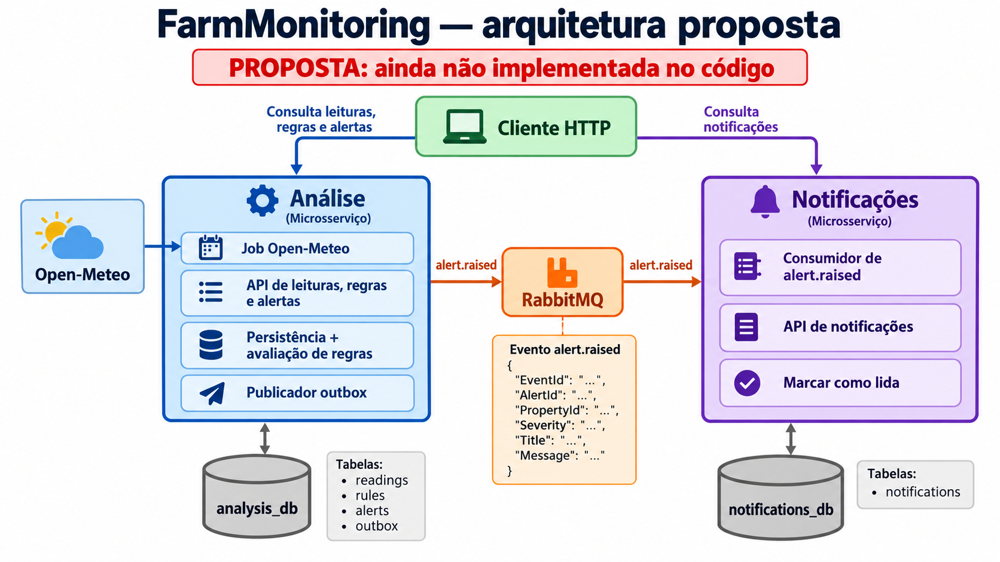

# Arquitetura proposta do FarmMonitoring

**Status: proposta; ainda não implementada.** O código atual continua com WeatherCollector, Storage, Analytics, Notifications e MonitoringApi e usa um banco `farm` compartilhado. O [fluxo atual](fluxo-farmmonitoring.png) descreve esse código.

## Limites dos serviços

| Serviço | Responsabilidade | Banco que pode acessar |
|---|---|---|
| Análise | Executar o job Open-Meteo, guardar leituras, administrar regras, avaliar medições, guardar alertas e oferecer HTTP para leituras, regras e alertas | `analysis_db` |
| Notificações | Consumir alertas, guardar notificações, listar e marcar como lidas por HTTP | `notifications_db` |

São **dois processos de aplicação**. O job de coleta fica dentro de Análise; as rotas HTTP ficam no serviço dono dos dados. Storage e a MonitoringApi genérica deixam de existir como processos separados. Os dois bancos podem estar no mesmo servidor PostgreSQL, mas cada serviço usa seu próprio banco e usuário. Nenhum serviço consulta tabelas do outro.

## Caminho de uma medição

1. O job de Análise consulta a Open-Meteo para uma propriedade do catálogo.
2. Análise grava a leitura em `analysis_db`, avalia as regras e grava os alertas gerados.
3. Para cada alerta, Análise registra uma mensagem pendente na tabela `outbox` na mesma transação. Um publicador envia `alert.raised` ao RabbitMQ.
4. Notificações recebe o evento, grava no seu banco e confirma a entrega. `EventId` impede gravar a mesma entrega duas vezes.
5. O cliente consulta leituras, regras e alertas na API de Análise; consulta notificações na API de Notificações.

O evento contém apenas `EventId`, `AlertId`, `PropertyId`, `Severity`, `Title` e `Message`. `AlertId` é uma referência externa em `notifications_db`, sem chave estrangeira entre os bancos. Notificações não precisa consultar Análise para montar o texto.

## Ordem de implementação

1. Criar `analysis_db` e `notifications_db` e separar as conexões.
2. Mover o job Open-Meteo, a gravação de leituras e as rotas de leitura, regras e alertas para Análise.
3. Mover as rotas de notificação para Notificações e remover sua dependência das tabelas de alertas.
4. Adicionar outbox em Análise e deduplicação de `AlertId`/`EventId` em Notificações.
5. Migrar os dados existentes, validar o fluxo completo e então remover Storage e MonitoringApi.

Até essa migração terminar, **não use este desenho como descrição do sistema em execução**.
